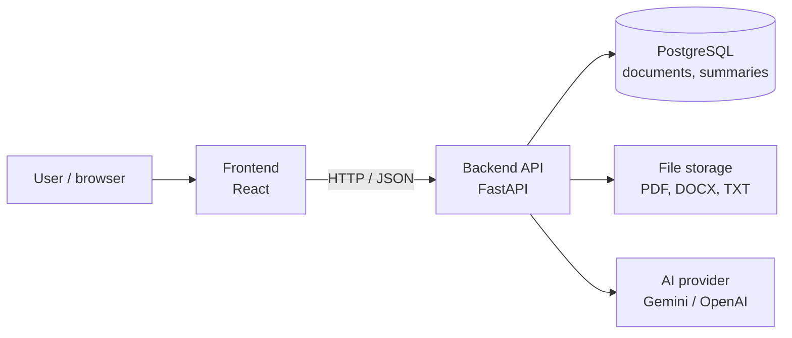

# Study Summarizer — Backend

Backend API for a web application that will help users generate
summaries from uploaded study documents.

Built with Python and FastAPI.

## Current functionality

The API currently provides:

- `GET /health` — checks that the API responds.
- `GET /api/documents` — returns the sample document list.
- `GET /api/documents/{document_id}` — returns a sample document by ID.
  Returns HTTP 404 if the document does not exist.

## Development status

Document data is currently stored in a hardcoded Python list for
development and learning purposes.

File upload, database persistence, and AI summarization are planned
for later stages.

## Architecture

The Study Summarizer consists of two applications:

- **Backend** (this repository) — a REST API built with Python and FastAPI.
  It stores documents, extracts their text and generates summaries with an AI model.
- **Frontend** ([study-summarizer-frontend](https://github.com/cirdei-alin/study-summarizer-frontend))
  — a web interface where users upload documents and read summaries. Planned: React.

### Components



| Component | Role | Status |
| --- | --- | --- |
| FastAPI backend | Exposes the REST API | In progress |
| PostgreSQL + SQLAlchemy | Stores document details and summaries | Planned (M1) |
| File storage | Stores uploaded files on disk; Azure Blob Storage after deployment | Planned (M2) |
| AI provider | Generates summaries; kept behind one service so the provider can be changed | Planned (M3) |
| React frontend | User interface | Planned (M4) |

### Main flow: from upload to summary

1. The user uploads a document from the frontend.
2. The backend saves the file and creates a database record with status `pending`.
3. The user requests a summary.
4. The backend extracts the text from the file and sends it to the AI provider.
5. The summary is saved in the database and the status becomes `summarized`.
6. The frontend shows the summary.

### Planned backend structure

```
app/
  main.py        # creates the FastAPI app
  routers/       # API endpoints, grouped by resource
  models/        # database tables (SQLAlchemy)
  schemas/       # request and response formats (Pydantic)
  services/      # logic: file storage, text extraction, AI
  database.py    # database connection
tests/
```

## Project planning

- [Milestones](https://github.com/cirdei-alin/study-summarizer-backend/milestones) — project stages and deadlines
- [Project board](https://github.com/users/cirdei-alin/projects/4) — to-do list and progress

## Requirements

- Python 3.15.2 — the version used during development
- Git

## Local setup — Windows with Git Bash

Clone the repository and enter its directory:

```bash
git clone https://github.com/cirdei-alin/study-summarizer-backend.git
cd study-summarizer-backend
```

Create and activate a virtual environment:

```bash
python -m venv .venv
source .venv/Scripts/activate
```

Install the dependencies:

```bash
python -m pip install -r requirements.txt
```

## Run the application

From the repository directory, with the virtual environment active:

```bash
python -m uvicorn main:app --reload
```

The API runs locally at http://127.0.0.1:8000.

Interactive API documentation is available at:
http://127.0.0.1:8000/docs

To stop the server, press Ctrl+C in the terminal.

## Manual checks

With the server running, test the following requests using `/docs`:

| Request | Expected result |
| --- | --- |
| `GET /health` | HTTP 200 and `{"status":"ok"}` |
| `GET /api/documents` | HTTP 200 and the sample document list |
| `GET /api/documents/D1` | HTTP 200 and document D1 |
| `GET /api/documents/D99` | HTTP 404 and `{"detail":"Document not found"}` |

## Automated tests

From the repository directory, with dependencies installed and the
virtual environment active, run:

```bash
python -m pytest
```

The tests check the health endpoint, sample document listing,
document lookup, and the HTTP 404 response for a missing document.