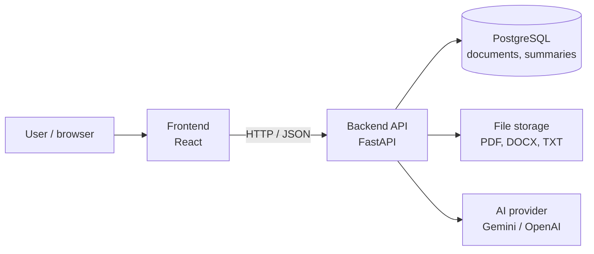

# Study Summarizer — Backend

Backend API for a web application that helps students generate
summaries from their study documents.

Built with Python, FastAPI and PostgreSQL.

## Current functionality

The API provides full CRUD for documents:

| Method | Endpoint | Description |
| --- | --- | --- |
| `GET` | `/health` | Checks that the API responds |
| `GET` | `/api/documents` | Lists all documents |
| `GET` | `/api/documents/{id}` | Returns one document, including its upload date |
| `POST` | `/api/documents` | Creates a document (`title`, `fileType`: pdf, docx or txt) |
| `PATCH` | `/api/documents/{id}` | Updates the title and/or file type |
| `DELETE` | `/api/documents/{id}` | Deletes a document |

Missing documents return HTTP 404. Invalid input (empty title,
unsupported file type, non-numeric ID) returns HTTP 422.

## Development status

Documents are stored in PostgreSQL through SQLAlchemy.
The React frontend lists, creates, edits and deletes documents.

Next stages: uploading real files (M2) and AI summaries (M3).

## Architecture

The Study Summarizer consists of two applications:

- **Backend** (this repository) — a REST API built with Python and FastAPI.
  It stores documents, extracts their text and generates summaries with an AI model.
- **Frontend** ([study-summarizer-frontend](https://github.com/cirdei-alin/study-summarizer-frontend))
  — a web interface built with React and Vite.

### Components



| Component | Role | Status |
| --- | --- | --- |
| FastAPI backend | Exposes the REST API | Done: documents CRUD |
| PostgreSQL + SQLAlchemy | Stores document details and summaries | Done (M1) |
| File storage | Stores uploaded files on disk; Azure Blob Storage after deployment | Planned (M2) |
| AI provider | Generates summaries; kept behind one service so the provider can be changed | Planned (M3) |
| React frontend | User interface | In progress (M4) |

### Main flow: from upload to summary

1. The user uploads a document from the frontend.
2. The backend saves the file and creates a database record with status `pending`.
3. The user requests a summary.
4. The backend extracts the text from the file and sends it to the AI provider.
5. The summary is saved in the database and the status becomes `summarized`.
6. The frontend shows the summary.

### Backend structure

```
app/
  main.py              # creates the FastAPI app, CORS, includes the routers
  database.py          # database connection and sessions
  models.py            # database tables (SQLAlchemy)
  schemas.py           # request and response formats (Pydantic)
  routers/
    documents.py       # /api/documents endpoints
tests/
  conftest.py          # test fixture: separate test database with sample data
  test_main.py         # API tests
create_tables.py       # creates the database tables
```

`models.py` and `schemas.py` will be split into folders when more
tables are added (summaries, users).

## Project planning

- [Milestones](https://github.com/cirdei-alin/study-summarizer-backend/milestones) — project stages
- [Project board](https://github.com/users/cirdei-alin/projects/4) — to-do list and progress

## Requirements

- Python 3.15 — the version used during development
- PostgreSQL 18
- Git

## Local setup — Windows with Git Bash

### 1. Get the code and install the dependencies

```bash
git clone https://github.com/cirdei-alin/study-summarizer-backend.git
cd study-summarizer-backend
python -m venv .venv
source .venv/Scripts/activate
python -m pip install -r requirements-dev.txt
```

### 2. Set up PostgreSQL

1. Install PostgreSQL from https://www.postgresql.org/download/windows/
   (include pgAdmin 4 and the Command Line Tools). Remember the password
   you choose for the `postgres` user.
2. In pgAdmin, create two databases:
   - `study_summarizer` — used by the application
   - `study_summarizer_test` — used only by the automated tests
3. Copy `.env.example` to `.env` and replace `YOUR_PASSWORD` with your
   PostgreSQL password. The `.env` file is ignored by Git.
4. Create the tables:

```bash
python create_tables.py
```

## Run the application

From the repository directory, with the virtual environment active:

```bash
python -m uvicorn app.main:app --reload
```

The API runs locally at http://127.0.0.1:8000.

Interactive API documentation is available at:
http://127.0.0.1:8000/docs

To stop the server, press Ctrl+C in the terminal.

## Manual checks

With the server running, test the following requests using `/docs`:

| Request | Expected result |
| --- | --- |
| `GET /health` | HTTP 200 and `{"status":"ok"}` |
| `POST /api/documents` with `{"title": "Test", "fileType": "pdf"}` | HTTP 201 and the new document ID |
| `GET /api/documents` | HTTP 200 and the list of documents |
| `PATCH /api/documents/{id}` with `{"title": "New title"}` | HTTP 200 and the updated document |
| `DELETE /api/documents/{id}` | HTTP 200 and a confirmation message |
| `GET /api/documents/999` | HTTP 404 and `{"detail":"Document not found"}` |

## Automated tests

```bash
python -m pytest
```

The tests run against the separate `study_summarizer_test` database.
Before each test, a fixture creates the tables and adds two sample
documents; after the test, the tables are dropped, so every test starts
from the same state.

They cover listing, reading, creating, updating and deleting documents,
validation errors (HTTP 422), missing documents (HTTP 404) and CORS.

## Continuous integration

GitHub Actions runs the tests on every push and pull request to `main`,
using its own PostgreSQL service container.